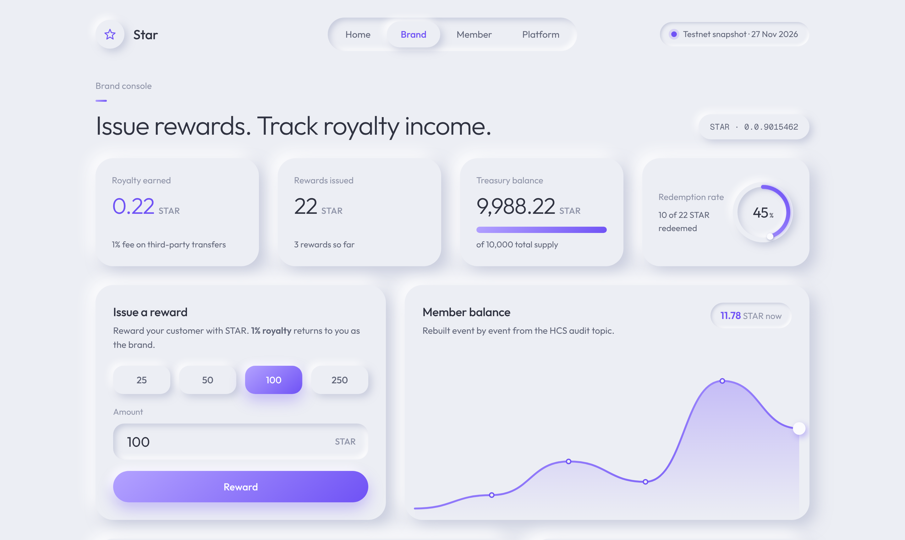

# Hedera STAR Loyalty

**Loyalty points are a liability nobody outside the merchant can audit.** This prototype issues
a loyalty token whose reward rule and audit trail are enforced by the network itself: a
fungible **STAR** token on Hedera with a 1% protocol-level fee, every reward and redemption
logged to a consensus-timestamped topic, and a dashboard to run it live.

> **Status:** working prototype on Hedera **testnet**. A self-directed study project, not
> production software, and not affiliated with Hedera or Hashgraph. Every behavior shown is a
> real protocol primitive, not a contract simulation.



Walkthrough of the interface, recorded on a snapshot of the real testnet state (27 Nov 2026):

https://github.com/user-attachments/assets/e328a438-67b9-4926-955f-9371a4cb2b34

## The problem

Merchant loyalty runs on closed points systems. The merchant's database is the only record of
what was issued, to whom and why, so customers, finance teams and auditors have to trust it.
The usual Web3 answer is an ERC-20 token with reward logic in a Solidity contract, which moves
the trust problem into custom code that has to be audited and pays variable gas on every use.

The question this prototype tests: **can the reward rule and the audit trail be native to the
protocol, with no contract code at all?**

## What it showed

Yes. The token, the fee and the audit log below are live on testnet and can be checked
independently (verified against the public mirror node on 24 November 2026):

| What | Evidence |
|---|---|
| STAR token, 10,000 fixed supply, 6 decimals | [Token 0.0.9015462](https://hashscan.io/testnet/token/0.0.9015462) |
| 1% fractional fee, collected by the merchant, set with no contract | Fee schedule on the token page |
| Reward of 15 STAR, with 0.15 STAR assessed to the merchant | [Transaction](https://hashscan.io/testnet/transaction/0.0.9004631%401779314020.434932184) |
| Redemption of 7 STAR back to the merchant, with no fee assessed | Message 5 on the audit topic |
| Five loyalty events logged with consensus timestamps | [Topic 0.0.9015468](https://hashscan.io/testnet/topic/0.0.9015468) |

Three things only became clear by building it:

- **A receipt does not prove the fee was collected.** The receipt returns status and IDs. Only
  the transaction *record* carries `assessedCustomFees`, so fee verification has to read the record.
- **Receiving a token is opt-in.** A Hedera account must associate a token before it can hold
  it. Left visible, that step is the biggest onboarding risk for a consumer product.
- **Governance is fixed at creation.** This token was created with only a fee-schedule key. It
  has no admin, supply, freeze, KYC, wipe or pause key, so nobody can mint more, freeze a holder
  or delete it. Keys left unset can never be added later.

Testnet is reset from time to time. If the links above stop resolving, run the scripts to
recreate everything.

## Product thinking behind it

The prototype came first. The product artifacts were written from what it demonstrated:
**prototype → evidence → spec**.

| Document | What it answers |
|---|---|
| [Problem frame](pm-operating-model/01-problem-frame.md) | The problem, who has it, why now |
| [Hypotheses](pm-operating-model/02-hypotheses.md) | The bets, each with a kill criterion |
| [PRD](pm-operating-model/03-prd.md) | Goals, non-goals, users, requirements |
| [Epics & user stories](pm-operating-model/04-epics-user-stories.md) | The work as thin, demoable slices |
| [Metrics](pm-operating-model/05-metrics.md) | North Star, input metrics, guardrails |
| [Roadmap & prioritization](pm-operating-model/06-roadmap-prioritization.md) | Now / next / later and how it was sequenced |
| [Technical design note](pm-operating-model/07-tech-spec-hip.md) | The three load-bearing technical decisions |

One level up from the product: [Strategy memo: institutional tokenization is a product problem](strategy-memo.md),
an outside-in thesis on where a tokenization product area should focus, scored against what has shipped.

## What it demonstrates technically

- **HTS (Hedera Token Service)** — native fungible token creation, no smart contract required
- **Custom fees as a protocol primitive** — `CustomFractionalFee` enforced by consensus, not by contract code
- **Capability-key model** — fine-grained governance (admin / supply / freeze / kyc / wipe / pause / feeScheduleKey)
- **Explicit token association** — opt-in receive (Hedera's anti-spam mechanism)
- **HCS (Hedera Consensus Service)** — append-only message log with consensus-ordered timestamps
- **Receipt vs Record** — when to use each, and how `assessedCustomFees` on the record proves on-chain fee collection
- **ECDSA (secp256k1) keys** — used throughout for EVM-address compatibility

## Prerequisites

- Node.js 18+ (the scripts use ES modules and top-level `await`)
- A funded Hedera **testnet** account from [portal.hedera.com](https://portal.hedera.com) (1000 free test HBAR)

## Setup

```bash
npm install
cp .env.example .env
```

Edit `.env` and fill in the operator credentials from [portal.hedera.com](https://portal.hedera.com). The rest of the variables (merchant / customer / token / topic IDs) are generated automatically by the scripts in subsequent steps and appended to `.env`.

> **Note:** The portal now defaults to ECDSA (secp256k1) keys for EVM interoperability. The code uses `PrivateKey.fromStringECDSA()` explicitly — never the generic `fromString()`, which can misdetect the key type and silently produce `INVALID_SIGNATURE` at execute time.

## Running

Each script does **one thing**, logs its result, and appends any new IDs to `.env` so subsequent scripts can pick them up. Scripts are idempotent — re-running a completed step is a no-op.

Run via npm scripts (recommended):

```bash
npm run connect           # sanity check: queries operator balance
npm run create-accounts   # creates merchant + customer accounts, funds each with 50 HBAR
npm run mint-token        # mints STAR (10,000 supply, 6 decimals, treasury = merchant)
npm run add-fee           # attaches 1% royalty fee to merchant
npm run associate         # opts customer in to receive STAR
npm run transfer          # transfers 100 STAR merchant → customer, verifies fee on record
npm run create-topic      # creates HCS audit-log topic
npm run submit-message    # submits loyalty-event JSON to the topic
npm run summary           # prints HashScan testnet URLs for all created resources
npm run reset-token       # clears token-dependent state from .env so you can re-mint
npm run web               # starts the interactive dashboard at http://localhost:7373
```

Or directly: `node scripts/01-create-accounts.js`.

## Web dashboard

After running the scripts through `submit-message` at least once (so the token and topic exist):

```bash
npm run web
```

Open `http://localhost:7373`. The dashboard has four views (Home, Brand, Member, Platform), two interactive actions and a live read of the on-chain state:

- **Reward customer** — operator → customer transfer. The 1% fractional fee is assessed and routed to merchant (neither party is exempt). Topup from merchant happens automatically if the operator pool is empty.
- **Customer redeems** — customer → merchant transfer. **No fee is assessed**: merchant is both treasury and fee collector, so the receiver-side exemption applies. This is the counterpart that demonstrates the exemption rule.
- Each action also submits a structured JSON event to the HCS topic, so the audit log updates live.

The view below the actions pulls from the public **Hedera Mirror Node REST API**:

- Token metadata + custom-fee schedule from `/api/v1/tokens/:id`
- Account balances (HBAR + STAR) from `/api/v1/accounts/:id`
- Transfers with `assessed_custom_fees` from `/api/v1/transactions/:id`, looked up by the transaction id each audit event carries (the list endpoint omits the fee field and stopped returning the older transactions)
- HCS messages from `/api/v1/topics/:id/messages`, base64-decoded to JSON

Architecture: the browser has no private keys. It only POSTs amounts to the local Node server, which holds the keys and signs/submits transactions. Read paths bypass the server entirely and hit the public mirror node — same separation of concerns as a real loyalty backend.

## Project layout

```
.
├── .env.example               # template — copy to .env and fill in operator credentials
├── package.json
├── README.md
├── pm-operating-model/        # problem frame, hypotheses, PRD, epics, metrics, roadmap, design note
│
├── lib/                       # shared helpers (used by scripts and web app)
│   ├── client.js              # buildClient() — testnet client + operator key loading
│   ├── env.js                 # appendEnv() — idempotent .env updates
│   └── hashscan.js            # HashScan URL builders, mirror node base URL
│
├── scripts/                   # CLI demos, one logical step per file
│   ├── 00-test-connection.js
│   ├── 01-create-accounts.js
│   ├── 02-mint-token.js
│   ├── 03-add-custom-fee.js
│   ├── 04-associate-token.js
│   ├── 05-transfer.js
│   ├── 06-create-topic.js
│   ├── 07-submit-message.js
│   ├── 97-reset-token-state.js
│   └── 99-summary.js
│
├── server.js                  # Node/Express: serves web/ and exposes /api/reward and /api/redeem
│
└── web/                       # interactive dashboard; reads from mirror node, writes via /api
    ├── index.html
    ├── app.js
    ├── style.css
    ├── snapshot.js            # testnet state captured on 27 Nov 2026, for viewing without the server
    └── fonts/                 # Outfit and Geist Mono, self-hosted (SIL OFL)
```

## Conventions

- **One script per logical step** — easier to read and walk through than a single monolith
- **ES modules** with top-level `await`
- **No smart contracts, no tests** — out of scope for a prototype
- **Comments only where Hedera behavior is non-obvious** — e.g., why the treasury must sign a token creation, or why the receipt is insufficient to verify a custom fee was collected
- **Testnet only** — never mainnet

## Why HTS instead of an ERC-20 contract?

| Concern | ERC-20 (Solidity) | HTS (this project) |
|---|---|---|
| Token creation | Deploy a contract | Single transaction, no bytecode |
| Custom transfer fees | Override `transfer()` / `_update()` | Native `CustomFractionalFee`, enforced by consensus |
| Governance roles | Diffused in contract code, often a single `owner` | Seven distinct optional keys, each potentially a different signer or multisig |
| Pausing | Only if the dev wrote `pause()` | Native `pauseKey` if set at creation |
| Cost predictability | Variable gas | Fixed USD-denominated fees |
| Mutability of capabilities | Whatever the contract allows | Decided at creation; unset keys are permanently absent |

The HTS model trades flexibility (you can't add arbitrary logic) for **predictability and explicit governance up-front**.

## Limitations

- Testnet only. Nothing here has been run on mainnet.
- Three accounts and one token. It demonstrates the mechanics, not behavior at scale or cost under load.
- Token association is visible. Hiding it behind onboarding is the top open product risk (see the PRD).
- The dashboard server holds the keys locally. A real deployment needs custody and key management.
- No automated tests.

## Resources

- [Hedera SDK reference](https://docs.hedera.com/hedera/sdks-and-apis/sdks)
- [HashScan testnet explorer](https://hashscan.io/testnet)
- [Hedera portal (testnet account)](https://portal.hedera.com)

---

Built by [Paulo Faulstich](https://github.com/paulo-faulstich) · 2026 · [MIT License](LICENSE)
